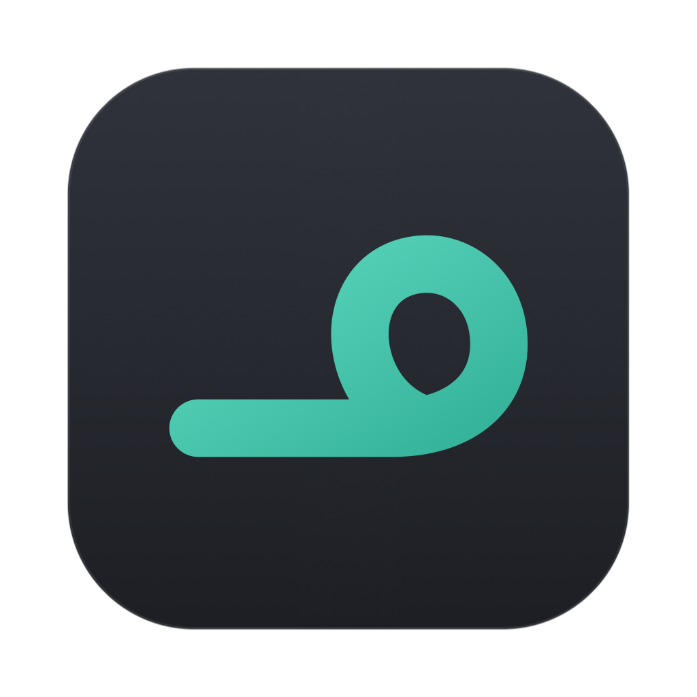
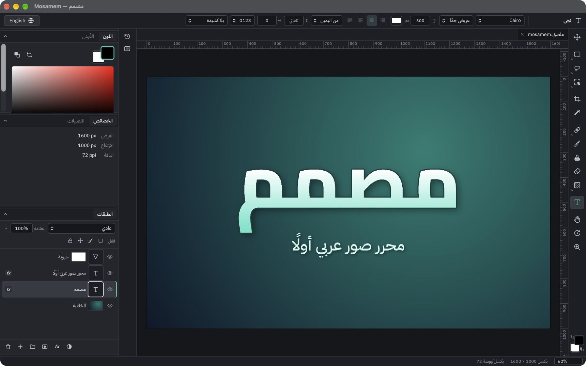

<p align="center">
  
</p>

<h1 align="center">Mosamem · مصمم</h1>

<p align="center">
  <b>English</b> · <a href="README.ar.md">العربية</a>
</p>

<p align="center">
  <a href="https://github.com/motalim-ai/mosamem/releases/latest"></a>
  
  
  <a href="LICENSE"></a>
</p>

---

**Mosamem** (مصمم, "designer") is a free, open-source image editor made for Arabic first. Layers, masks,
adjustment layers, filters, Arabic text that stays editable, layer styles, PSD files, and AI tools that run on
your own computer. The interface is Arabic, right to left, with English one click away.

<p align="center">
  
</p>

## Install

### Mac

1. Download **[Mosamem.dmg](https://github.com/motalim-ai/mosamem/releases/latest/download/Mosamem.dmg)** from the latest release.
2. Open it and drag **Mosamem** into **Applications**.
3. Open **Mosamem** from Applications. macOS shows *"Mosamem" Not Opened*. Press **Done**, not Move to Trash.
4. Open **System Settings → Privacy & Security**, scroll down to **Security**, and press **Open Anyway** next to
   *"Mosamem" was blocked to protect your Mac*.
5. Press **Open Anyway** again and enter your Mac password. Mosamem opens, and macOS will not ask again.

<details>
<summary>Prefer Terminal? One command does steps 3 to 5</summary>

```bash
xattr -dr com.apple.quarantine /Applications/Mosamem.app && open /Applications/Mosamem.app
```

</details>

**Why does macOS ask?** Mosamem is not notarized by Apple yet, so macOS asks once before opening any app
downloaded outside the App Store. The app is open source: you can read every line here, or build it yourself.

Requires macOS 13.4 Ventura or later on Apple silicon.

### Windows

1. Download **[Mosamem-Setup-x64.exe](https://github.com/motalim-ai/mosamem/releases/latest/download/Mosamem-Setup-x64.exe)**
   (most PCs) or **[Mosamem-Setup-arm64.exe](https://github.com/motalim-ai/mosamem/releases/latest/download/Mosamem-Setup-arm64.exe)**
   (Snapdragon and other ARM PCs).
2. Open the installer. If Windows shows *Windows protected your PC*, press **More info**, then **Run anyway**.
   If your browser says the file is not commonly downloaded, choose **Keep**.
3. Pick **العربية** or **English**, then **Next** and **Install**. No administrator password is needed: Mosamem
   installs for your account only.

**Why does Windows warn?** The installer is not code-signed yet, so SmartScreen does not know it. The SHA-256 of
each installer is listed in the release notes.

Requires Windows 10 or 11, 64-bit, with the WebView2 runtime (built into Windows 11; the installer adds it on
Windows 10 if it's missing). Remove it any time from **Settings → Apps**.

## What it can do

- **Documents**: new from presets (Instagram, YouTube thumbnail, A4…), open PNG, JPEG, WebP, TIFF, HEIC (Mac)
  and PSD; save as `.mosamem` with every layer kept; autosave and recovery after a crash.
- **Layers**: groups, blend modes, opacity and fill, clipping, locks, layer masks.
- **Non-destructive adjustments**: Levels, Curves, Hue/Saturation, Brightness/Contrast, Exposure, Vibrance,
  Color Balance, Black & White, Gradient Map, Invert, Threshold.
- **Selections**: marquee, lasso, polygon lasso, magic wand, quick selection, object selection, refine edge.
- **Painting**: brush, eraser, clone stamp, healing and spot healing, gradient, paint bucket, eyedropper.
- **Transform**: move, free transform, perspective, crop and straighten, image and canvas size.
- **Arabic text**: four bundled fonts (IBM Plex Sans Arabic, Cairo, Tajawal, Amiri), right-to-left and mixed
  text, diacritics, kashida justification. Text stays editable.
- **Layer styles**: drop shadow, inner shadow, outer glow, stroke, color and gradient overlay.
- **Filters**: Gaussian blur, motion blur, unsharp mask, noise, pixelate, with live preview.
- **PSD**: opens layered Photoshop files and saves a layered copy (see [docs/psd-report.md](docs/psd-report.md)).
- **Local AI**: Select Subject, Remove Background, Object Selection (click or box) and Smart Fill. Each model
  downloads once (28–115 MB) the first time you use it, then works offline.
- **Export**: PNG, JPEG, WebP, TIFF, HEIC (Mac): the whole picture, one layer or the selection, at any size,
  with the file size shown before you save.

What works and what isn't done yet, milestone by milestone, is in [docs/status.md](docs/status.md).

## Arabic and English

The interface starts in Arabic, right to left. The language button in the corner switches to English (left to
right) and back. Shortcuts follow the key's position, so they also work with an Arabic keyboard layout:
**Help → Keyboard Shortcuts** lists them.

## Build from source

You need [Rust](https://rustup.rs) and [Node.js](https://nodejs.org) 20 or later. On Windows, also the
Visual Studio C++ build tools.

```bash
git clone https://github.com/motalim-ai/mosamem.git
cd mosamem
npm install
npx tauri dev      # run it
npx tauri build    # the installer: a .dmg on Mac, an .exe on Windows
```

The first build downloads ONNX Runtime's prebuilt library (for the AI tools). Tests: `cargo test --workspace`
and `npx vitest run`.

<details>
<summary>Project layout</summary>

| Path | What's there |
| --- | --- |
| `crates/mosamem-core` | Pixel math: blending, adjustments, filters, selections, painting, resampling, Arabic text |
| `src-tauri/src/doc` | The document engine: layers, history, compositing, files, PSD |
| `src-tauri/src/ai` | Local AI: model downloads, the ONNX Runtime setup, the three models |
| `src/engine` | The GPU compositor (WebGL2) and the calls into the engine |
| `src/app` | The interface: tools, panels, dialogs, menus, Arabic and English text |
| `tools` | Test, measurement and screenshot scripts |
| `docs` | The plan, research notes, status and reports |

</details>

## Privacy

Mosamem never sends your pictures anywhere. It has no analytics and no account. The only network use is the
one-time download of an AI model, after you agree to it. A test (`tools/ai/no-network.sh`) checks that the AI
tools make no connections after that.

## License

Mosamem is free software under the [GNU General Public License v3.0](LICENSE): you can use it, study it, share
it and change it. If you distribute a modified version, it has to stay free under the same license. Bundled
fonts and libraries, and the AI models, keep their own licenses: see
[THIRD-PARTY-NOTICES.md](THIRD-PARTY-NOTICES.md).

Mosamem is not affiliated with Adobe. It contains no Adobe code or artwork; its behavior was learned from public
documentation.

The name **Mosamem** and its icon identify this project and are not covered by the license.

## Made by Motalim

<p align="center">
  <a href="https://www.youtube.com/@motalim-ai?sub_confirmation=1"></a>
</p>

Mosamem is made by **Motalim**. Tutorials and new tools are on
**[the Motalim YouTube channel](https://www.youtube.com/@motalim-ai?sub_confirmation=1)**.

Ideas, bugs or translations? [Open an issue](https://github.com/motalim-ai/mosamem/issues).
