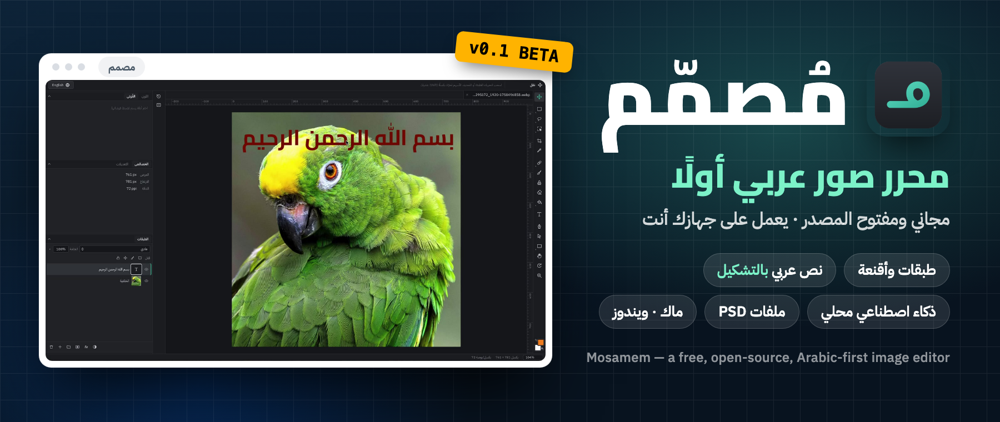
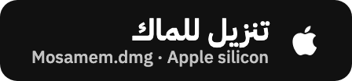

<div dir="rtl">

<p align="center">
  
</p>

<p align="center">
  <b>العربية</b> · <a href="README.en.md">English</a>
</p>

<p align="center">
  <a href="https://github.com/motalim-ai/mosamem/releases/latest"></a>
  
  
  <a href="LICENSE"></a>
</p>

**مصمم** محرر صور مجاني ومفتوح المصدر، صُنع **للعربية أولًا**: طبقات وأقنعة، وطبقات ضبط، وفلاتر، ونص عربي
يبقى قابلًا للتحرير، وأنماط طبقة، وملفات فوتوشوب PSD، وأدوات ذكاء اصطناعي تعمل على جهازك أنت دون إنترنت.
الواجهة عربية من اليمين إلى اليسار، والإنجليزية بضغطة زر. ويعمل على **الماك والويندوز**.

<p align="center">
  <a href="https://github.com/motalim-ai/mosamem/releases/latest/download/Mosamem.dmg"></a>
  &nbsp;
  <a href="https://github.com/motalim-ai/mosamem/releases/latest/download/Mosamem-Setup-x64.exe"></a>
</p>

> **نسخة تجريبية أولى (0.1).** بُني مصمم في يوم واحد، وما زال فيه ما لم يكتمل وما يحتاج إلى تجربة أكثر.
> جرّبه، وأخبرنا بما تريد أن نضيفه أولًا في [صفحة Issues](https://github.com/motalim-ai/mosamem/issues).

## شاهده وهو يعمل

<table>
  <tr>
    <td width="50%" valign="top">
      <b>إزالة الخلفية بضغطة</b><br>
      تحديد الكائن ثم «إزالة الخلفية»: ذكاء اصطناعي على جهازك، والريش محفوظ بدقة.<br><br>
      
    </td>
    <td width="50%" valign="top">
      <b>خلفية جديدة وأنماط الطبقة</b><br>
      طبقة تحت العنصر بتدرّج أو لون، ثم «تراكب لون» بمعاينة مباشرة.<br><br>
      
    </td>
  </tr>
  <tr>
    <td width="50%" valign="top">
      <b>نص عربي كما يجب أن يُكتب</b><br>
      حروف متصلة من اليمين إلى اليسار، وخط Cairo عريض، ولون، وظل ساقط وحدّ. والنص يبقى قابلًا للتعديل.<br><br>
      
    </td>
    <td width="50%" valign="top">
      <b>الأشكال</b><br>
      مستطيل وشكل بيضاوي، وكل شكل طبقة مستقلة تغيّر لونها ومقاسها من لوحة الخصائص.<br><br>
      
    </td>
  </tr>
</table>

## الكتابة العربية أولًا

<p align="center">
  
</p>

العربي مع الإنجليزي في السطر نفسه، والتشكيل في مكانه، والضبط بالكشيدة، وأربعة خطوط عربية مدمجة:
IBM Plex Sans Arabic وCairo وTajawal وAmiri.

## لقطات من البرنامج

<table>
  <tr>
    <td width="50%"><br><b>تنقيح الحواف</b>: نعومة وتمويه وإزاحة للحافة، بمعاينة على خلفية سوداء أو حمراء.</td>
    <td width="50%"><br><b>أنماط الطبقة</b>: ظل ساقط وداخلي، وتوهج، وحدّ، وتراكب لون وتدرّج.</td>
  </tr>
  <tr>
    <td width="50%"><br><b>الفرشاة</b>: الحجم والصلابة والتدفق، مع ختم النسخ والمعالجة والممحاة.</td>
    <td width="50%"><br><b>نماذج الذكاء الاصطناعي</b>: تُنزَّل مرة واحدة (28–115 ميجا)، ثم تعمل دون إنترنت.</td>
  </tr>
  <tr>
    <td width="50%"><br><b>على ويندوز أيضًا</b>: نفس البرنامج ونفس العربية على ويندوز 10 و11.</td>
    <td width="50%"><br><b>عربي ⇄ English</b>: زر واحد يقلب الواجهة كلها، والاختصارات تعمل مع لوحة المفاتيح العربية.</td>
  </tr>
</table>

## التثبيت

### ماك

1. نزّل **[Mosamem.dmg](https://github.com/motalim-ai/mosamem/releases/latest/download/Mosamem.dmg)** من آخر إصدار.
2. افتحه واسحب **Mosamem** إلى مجلد **Applications** (التطبيقات).
3. افتح **Mosamem** من التطبيقات. سيظهر *لم يتم فتح "Mosamem"*. اضغط **تم**، لا «نقل إلى سلة المهملات».
4. افتح **إعدادات النظام ← الخصوصية والأمن**، وانزل إلى قسم **الأمن**، واضغط **فتح على أي حال** بجانب
   *تم حظر "Mosamem" لحماية جهاز Mac*.
5. اضغط **فتح على أي حال** مرة أخرى وأدخل كلمة سر جهازك. يفتح مصمم، ولن يسألك macOS مرة أخرى.

<details>
<summary>تفضّل الطرفية (Terminal)؟ أمر واحد يغني عن الخطوات 3 إلى 5</summary>

```bash
xattr -dr com.apple.quarantine /Applications/Mosamem.app && open /Applications/Mosamem.app
```

</details>

**لماذا يسأل macOS؟** لأن مصمم لم يُوثَّق من أبل بعد، فيسأل النظام مرة واحدة قبل فتح أي تطبيق نُزّل من خارج
متجر التطبيقات. البرنامج مفتوح المصدر: يمكنك قراءة كل سطر منه هنا، أو بناؤه بنفسك.

يحتاج macOS 13.4 (Ventura) أو أحدث على معالجات Apple (M1 وما بعده).

### ويندوز

1. نزّل **[Mosamem-Setup-x64.exe](https://github.com/motalim-ai/mosamem/releases/latest/download/Mosamem-Setup-x64.exe)**.
   ويعمل أيضًا على أجهزة Snapdragon وغيرها من أجهزة ARM، عبر محاكاة x64 المدمجة في ويندوز.
2. افتح المثبّت. إن ظهرت رسالة *Windows protected your PC*، اضغط **More info** (مزيد من المعلومات)، ثم
   **Run anyway** (التشغيل على أي حال). وإن قال المتصفح إن الملف غير شائع التنزيل، اختر **Keep** (الاحتفاظ).
3. اختر **العربية** أو **English**، ثم **التالي** و**تثبيت**. لا حاجة لكلمة سر المسؤول: يُثبَّت مصمم لحسابك فقط.

**لماذا يحذّر ويندوز؟** لأن المثبّت غير موقّع رقميًا بعد، فلا يعرفه SmartScreen. بصمة SHA-256 لكل مثبّت
مكتوبة في ملاحظات الإصدار.

يحتاج ويندوز 10 أو 11 بنظام 64 بت، مع WebView2 (مدمج في ويندوز 11، ويضيفه المثبّت على ويندوز 10 إن لم يكن
موجودًا). يمكنك إزالته متى شئت من **الإعدادات ← التطبيقات**.

## كل ما يفعله

- **المستندات**: مستند جديد من مقاسات جاهزة (إنستغرام، صورة يوتيوب المصغرة، A4…)، وفتح PNG وJPEG وWebP وTIFF
  وHEIC (على الماك) وPSD، والحفظ بصيغة `.mosamem` مع كل الطبقات، وحفظ تلقائي واسترجاع بعد الانهيار.
- **الطبقات**: مجموعات، وأنماط مزج، وعتامة وتعبئة، وقص، وأقفال، وأقنعة طبقات.
- **ضبط غير هدّام**: المستويات، والمنحنيات، والتدرج/التشبع، والسطوع/التباين، والتعريض، والحيوية، وتوازن
  الألوان، والأبيض والأسود، وخريطة التدرج، والعكس، والعتبة.
- **التحديد**: المستطيل والبيضاوي، والحبل، والحبل المضلّع، والعصا السحرية، والتحديد السريع، وتحديد الكائن،
  وتنقيح الحواف.
- **الرسم**: الفرشاة، والممحاة، وختم النسخ، والمعالجة والمعالجة الموضعية، والتدرج، والدلو، والقطارة.
- **التحويل**: النقل، والتحويل الحر، والمنظور، والقص والتسوية، وحجم الصورة واللوحة.
- **النص العربي**: أربعة خطوط مدمجة (IBM Plex Sans Arabic وCairo وTajawal وAmiri)، واتجاه من اليمين لليسار
  ونص مختلط، وتشكيل، وضبط بالكشيدة. والنص يبقى قابلًا للتحرير.
- **الأشكال والقلم**: أدوات المستطيل والشكل البيضاوي والمضلّع والنجمة والخط، والقلم وتحديد النقاط، مع تعبئة
  وحدّ يبقيان قابلين للتعديل، وتحويل المسار إلى تحديد وبالعكس، وتعبئة المسار ورسم حدّه.
- **أنماط الطبقة**: الظل المسقط، والظل الداخلي، والتوهج الخارجي، والحد، وتراكب اللون والتدرج.
- **الفلاتر**: التمويه الغاوسي، وتمويه الحركة، والتوضيح، والضجيج، والبكسلة، مع معاينة حيّة.
- **PSD**: يفتح ملفات فوتوشوب بطبقاتها، ويحفظ نسخة بطبقاتها (انظر [docs/psd-report.md](docs/psd-report.md)).
- **ذكاء اصطناعي محلي**: تحديد العنصر، وإزالة الخلفية، وتحديد الكائن (بالنقر أو بمربع)، والملء الذكي. كل نموذج
  يُنزَّل مرة واحدة (28–115 ميجا) عند أول استخدام، ثم يعمل دون إنترنت.
- **التصدير**: PNG وJPEG وWebP وTIFF وHEIC (على الماك): الصورة كاملة، أو طبقة واحدة، أو التحديد، بأي مقاس،
  مع عرض حجم الملف قبل الحفظ.

ما يعمل وما لم يكتمل بعد، مرحلة مرحلة، في [docs/status.md](docs/status.md).

## العربية والإنجليزية

تبدأ الواجهة بالعربية من اليمين إلى اليسار، وزر اللغة في الزاوية يحوّلها إلى الإنجليزية ويعيدها. والاختصارات
تعمل بموضع المفتاح، فتعمل مع لوحة المفاتيح العربية أيضًا. تجدها كلها في **مساعدة ← اختصارات لوحة المفاتيح**.

## الخصوصية

مصمم لا يرسل صورك إلى أي مكان. لا إحصاءات ولا حساب. الاستخدام الوحيد للإنترنت هو تنزيل نموذج ذكاء اصطناعي مرة
واحدة، بعد موافقتك. واختبار (`tools/ai/no-network.sh`) يتحقق من أن أدوات الذكاء الاصطناعي لا تتصل بشيء بعد
ذلك.

## البناء من المصدر

تحتاج [Rust](https://rustup.rs) و[Node.js](https://nodejs.org) الإصدار 20 أو أحدث. وعلى ويندوز أيضًا أدوات
البناء C++ من Visual Studio.

```bash
git clone https://github.com/motalim-ai/mosamem.git
cd mosamem
npm install
npx tauri dev      # للتشغيل
npx tauri build    # المثبّت: ملف .dmg على الماك، و.exe على ويندوز
```

ويمكن بناء مثبّت ويندوز على الماك أيضًا: `tools/windows/cross-build.sh` ثم `tools/windows/make-installer-vm.sh`
الذي يشغّل NSIS على جهاز ويندوز عبر SSH.

البناء الأول ينزّل مكتبة ONNX Runtime الجاهزة (لأدوات الذكاء الاصطناعي). الاختبارات: `cargo test --workspace`
و`npx vitest run`.

<details>
<summary>تنظيم المشروع</summary>

| المسار | ما فيه |
| --- | --- |
| `crates/mosamem-core` | حسابات البكسل: المزج، والضبط، والفلاتر، والتحديد، والرسم، وتغيير المقاس، والنص العربي |
| `src-tauri/src/doc` | محرّك المستند: الطبقات، والسجل، والتركيب، والملفات، وPSD |
| `src-tauri/src/ai` | الذكاء الاصطناعي المحلي: تنزيل النماذج، وتهيئة ONNX Runtime، والنماذج الثلاثة |
| `src/engine` | المركّب على كرت الشاشة (WebGL2) والاتصال بالمحرّك |
| `src/app` | الواجهة: الأدوات، واللوحات، والنوافذ، والقوائم، ونصوص العربية والإنجليزية |
| `tools` | سكربتات الاختبار والقياس واللقطات |
| `docs` | الخطة، وملاحظات البحث، والحالة، والتقارير |

</details>

## الرخصة

مصمم برنامج حر بموجب [رخصة جنو العمومية الإصدار 3](LICENSE): يمكنك استخدامه ودراسته ومشاركته وتعديله. وإن
وزّعت نسخة معدّلة فيجب أن تبقى حرة بالرخصة نفسها. الخطوط والمكتبات المدمجة ونماذج الذكاء الاصطناعي لها
رخصها الخاصة: انظر [THIRD-PARTY-NOTICES.md](THIRD-PARTY-NOTICES.md).

مصمم غير تابع لشركة Adobe، ولا يحتوي أي كود أو رسومات منها؛ سلوكه مأخوذ من التوثيق العام المنشور.

اسم **مصمم** وأيقونته يعرّفان هذا المشروع، ولا تشملهما الرخصة.

## من صنع متعلم

</div>

<p align="center">
  <a href="https://www.youtube.com/@motalim-ai?sub_confirmation=1"></a>
</p>

<div dir="rtl">

مصمم من صنع **متعلم**. الشروحات والأدوات الجديدة على
**[قناة متعلم على يوتيوب](https://www.youtube.com/@motalim-ai?sub_confirmation=1)**.

أفكار أو مشكلات أو ترجمات؟ [افتح Issue](https://github.com/motalim-ai/mosamem/issues).

</div>
